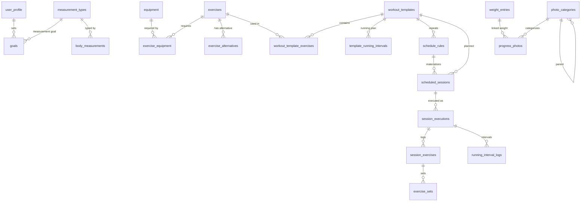

# VYRO database schema

Source of truth: `src/db/migrations/`. Keep this file updated with every migration.
Models and Zod schemas: `src/types/domain.ts`. Row mapping: `src/db/mappers.ts`.

| Migration    | Contents                                |
| ------------ | --------------------------------------- |
| m001_initial | 22 tables + 15 indexes (full V1 schema) |

## Conventions

- `id TEXT` UUID v4. `created_at`, `updated_at` ISO UTC. `deleted_at` soft delete (NULL = active).
- Booleans `INTEGER 0/1`, JSON `TEXT`, enums `TEXT` + `CHECK` (values in `src/types/enums.ts`).
- Canonical units: kg, cm, km, km/h, %. `unit_entered` keeps what the user typed (AD-06).
- Calendar values are local: `scheduled_date 'YYYY-MM-DD'`, `start_time 'HH:mm'`. Instants are UTC (AD-05).
- Photo paths are **relative** to the private photo root (AD-13).

## Entity map

Standalone: `app_settings` (key/value JSON), `notification_schedules` (OS id mapping, rebuilt by reconcile).

## Invariants (enforced in repositories, step 10)

1. At most one `session_executions` row with `status = 'in_progress'`.
2. A `type = 'rest'` scheduled session never gets an execution.
3. Completing an execution sets its scheduled session to `completed` (outcome `as_planned`) or `modified` (`modified` / `partial`). Planned date, time and snapshot stay untouched.
4. Rescheduling updates `scheduled_date` / `start_time`, increments `reschedule_count`, keeps `original_date`.
5. A template referenced by any execution is archived, never deleted. History renders from `planned_snapshot`.
6. `UNIQUE(rule_id, original_date)` makes rule materialization idempotent (enforced by SQL).

## Checks

- `src/db/__tests__/schema.test.ts`: every table and index exists, `PRAGMA foreign_key_check` is empty, each model's fields equal its table's columns, and every table round-trips through SQL.
- `src/db/__tests__/lock.test.ts`: released migrations never change (`pnpm db:lock` records new ones).
